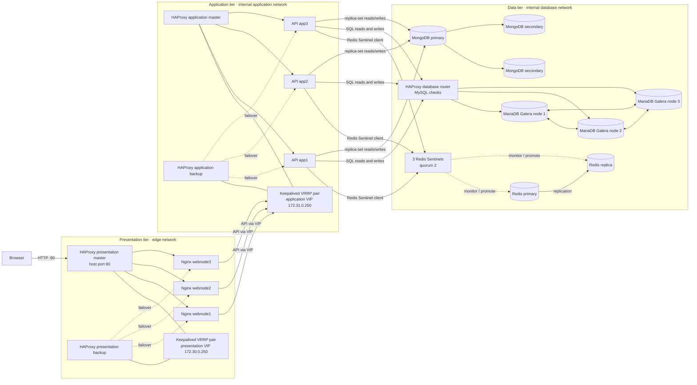

# Distributed three-tier store demo

The stack serves a static storefront through three Nginx presentation nodes.
Three Node.js API nodes query a MariaDB Galera cluster through a MySQL-aware
HAProxy database router, cache the ten cheapest products through Redis
Sentinel, and store product reviews in a three-member MongoDB replica set.
Keepalived provides a master/backup virtual IP for the presentation and API
load balancers.

## Architecture



Product-list requests check Redis first; a cache miss queries MariaDB and then
populates Redis. Review requests use MongoDB, with MariaDB used to verify the
product before a review is inserted. In this single-host Compose setup, host
port 80 is published by the presentation master container; the presentation
VIP does not move Docker's host-port mapping during failover.

## Run locally

1. Run `./scripts/prepare-local.ps1` in PowerShell. It creates local passwords
   for the MongoDB application user and Redis, plus the ignored replica-set
   keyfile. Review `.env` and replace the example passwords.
2. Start the stack with `docker compose up --build`.
3. Open `http://localhost/` for the storefront and
   `http://localhost:8088/` for Nagios.

For a normal stop and restart, let `docker compose down` finish before running
`docker compose up -d` again. The Galera services have a one-minute shutdown
grace period, and their dependencies stop the nodes in sequence so `galera1`
is the last node shut down and can be marked safe for the next bootstrap. Do
not use `docker compose down -v` unless you intend to delete the database data.

The product endpoint is `http://localhost/api/products/cheapest`; it returns
JSON sorted by ascending price. The storefront calls this endpoint and renders
the returned products. `mongo-init` initializes the MongoDB replica set and
least-privilege application user. Schema and sample data setup are idempotently
performed by `catalog-init` after the database router and dependencies start.

The storefront also displays a live request pipeline for its product and
review API requests. The API's `X-Request-Trace` response header records the
presentation load balancer, selected web node, application load balancer,
application node, and the actual data stores touched by that request.
The storefront API explorer menu can query `/`, `/health`,
`/products/cheapest`, and `/products/ST-001/reviews`.

Use the storefront's API explorer menu to query the product, review, service
information, and health endpoints. Its **Clear Redis catalog cache** button
calls `POST /api/cache/clear`, which deletes only the cheapest-products cache
entry; the next catalog request refills it from MariaDB.

The application uses Redis as a **disposable cache** for the cheapest-products
response for 60 seconds. Redis RDB and AOF persistence are disabled; loss of
cache contents is safe because the API reads through to Galera and repopulates
the cache. Sentinel monitors one primary, one replica, and a quorum of two
Sentinels for failover. If Redis is unavailable, product requests bypass the
cache; `/health` reports the cache state without marking the API unhealthy.
MongoDB stores reviews in a three-member replica set; the API authenticates as
a user with `readWrite` permissions only on the reviews database. Use
`GET /api/products/ST-001/reviews` to read reviews or send JSON such as
`{"reviewer":"Taylor","rating":5,"comment":"Great bag."}` to
`POST /api/products/ST-001/reviews` to add one. The initialization service
creates the review index and inserts sample reviews idempotently. MongoDB,
Redis, and the database router are private to the database network and are not
published on host ports.

The HAProxy database router performs MySQL protocol health checks and balances
connections across available Galera nodes. Since Galera is multi-primary, both
reads and writes use all healthy nodes; this demo does not split reads to
secondaries. Each API node has a bounded MariaDB pool of five connections by
default. With three API nodes, that allows at most 15 application connections
through the router; adjust `DB_POOL_LIMIT` with the planned API replica count
and MariaDB connection budget in mind.

These replicas run as containers on one Docker host. The failover exercises
demonstrate recovery from individual service/container failures, but do not
protect the data tier from a laptop, Docker Desktop, or host failure.

To inspect MongoDB replica-set status from the primary:

```powershell
docker compose exec mongodb1 sh -c 'mongosh --quiet --username "$MONGO_INITDB_ROOT_USERNAME" --password "$MONGO_INITDB_ROOT_PASSWORD" --authenticationDatabase admin --eval "rs.status().members.map(({name,stateStr}) => ({name,stateStr}))"'
```

To inspect which Redis node Sentinel currently considers primary:

```powershell
docker compose exec redis-sentinel1 sh -c 'redis-cli -p 26379 -a "$REDIS_PASSWORD" SENTINEL get-master-addr-by-name store-cache'
```

## Load-balancer failover

The presentation VIP is `172.30.0.250` and the application VIP is
`172.31.0.250`. Each Keepalived pair shares its HAProxy container's network
namespace, uses unicast VRRP, and tracks the local HAProxy listener. Application
requests from Nginx use the floating application VIP.

Compose publishes host port 80 on the presentation master container. Docker's
published-port mapping targets that specific container, so on a single-host
Compose deployment the VIP failover does not move the host port mapping. The
presentation VIP is available to other containers on the edge network; expose
it through a host/network setup that supports floating VIPs if host-level
failover is required.
