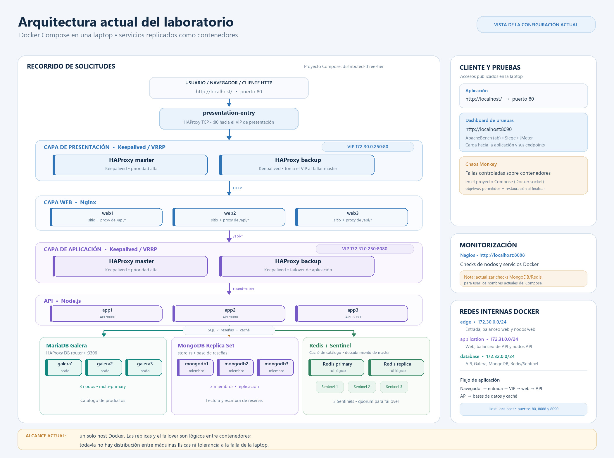

# Sistema distribuido de tres capas

Demostración de una tienda web con Nginx, Node.js, balanceo con HAProxy y Keepalived, MariaDB Galera, MongoDB y Redis Sentinel.

## Estado y alcance actuales

El laboratorio corre con Docker Compose en **una sola laptop**. Los nodos web, API y base de datos son contenedores separados, pero comparten Docker Engine, sistema operativo, disco y recursos de la laptop. Esto permite probar balanceo y fallas de contenedores, pero no simula la tolerancia a la falla de una máquina física.

Las dos máquinas virtuales Ubuntu existentes no forman parte del despliegue actual. No se han configurado ni modificado para esta topología.

## Arquitectura

Flujo principal:

1. El navegador accede a `http://localhost/`, publicado en el puerto 80.
2. El contenedor `presentation-entry` envía el tráfico al VIP de presentación `172.30.0.250:80`.
3. El par HAProxy de presentación, supervisado por Keepalived, balancea las solicitudes entre `web1`, `web2` y `web3`.
4. Las solicitudes `/api/*` de Nginx se envían al VIP de aplicación `172.31.0.250:8080`.
5. El par HAProxy de aplicación balancea entre `app1`, `app2` y `app3`.
6. La API consulta MariaDB mediante `database-proxy`, lee y escribe reseñas en el replica set MongoDB, y consulta Redis mediante Sentinel para la caché del catálogo.

Los VIPs viven en las redes internas de Docker. En este Compose local, el puerto 80 del host lo publica `presentation-entry`; Docker no mueve ese mapeo cuando Keepalived transfiere el VIP. Por ello, la continuidad de acceso desde el host al detener el balanceador de presentación no está garantizada por esta topología.

### Redes Docker

| Red | Subred | Componentes principales |
|---|---|---|
| `edge` | `172.30.0.0/24` | Entrada, balanceadores de presentación, nodos web y herramientas del laboratorio |
| `application` | `172.31.0.0/24` | Nginx, balanceadores de aplicación y API |
| `database` | `172.32.0.0/24` | API, proxy de Galera, MariaDB, MongoDB y Redis |

Puertos disponibles en la laptop:

| URL | Uso |
|---|---|
| `http://localhost/` | Tienda web y API detrás de la entrada |
| `http://localhost:8090/` | Dashboard de pruebas |
| `http://localhost:8088/` | Nagios; usuario predeterminado `nagiosadmin`, contraseña definida en `.env` |

## Mejoras implementadas

El trabajo cubre los puntos 2.1, 2.2, 2.3 y todo el punto 3 de `ToDo.md`.

### MongoDB — ToDo 2.1

- Tres instancias forman el replica set autenticado `store-rs`.
- La comunicación interna del replica set usa un keyfile.
- `mongo-init` configura el replica set y crea un usuario de aplicación con permisos `readWrite` limitados a la base de datos de reseñas.
- La inicialización crea el índice e inserta reseñas de ejemplo de forma idempotente.
- La API se conecta a los tres miembros como semillas y el driver sigue al primario elegido por MongoDB.

La replicación está dentro de un solo host; una réplica no protege contra la pérdida de la laptop. No se han documentado ni probado respaldos y restauraciones de MongoDB.

### Redis — ToDo 2.2 y 2.3

- Redis usa un nodo primario, una réplica y tres procesos Sentinel; el quorum configurado es dos.
- La API pregunta a Sentinel cuál es el primario actual en vez de fijar la conexión a una instancia.
- Redis es una caché desechable para los diez productos más baratos. Las respuestas se guardan por 60 segundos.
- RDB y AOF están deshabilitados. Si la caché no está disponible, la API consulta MariaDB y `/api/health` informa el estado de la caché sin declarar toda la API no saludable.
- `POST /api/cache/clear` borra únicamente la clave de caché del catálogo; la siguiente lectura la vuelve a cargar desde MariaDB.

No se ha ejecutado una prueba de failover de Redis en esta ronda. Las instancias y Sentinels también comparten el mismo host.

### MariaDB Galera — ToDo 3 completo

- Tres nodos MariaDB se unen al clúster `distributed-cluster`.
- La aplicación ya no apunta directamente a `galera1`: usa el contenedor `database-proxy`.
- HAProxy revisa el protocolo MySQL, retira nodos no disponibles y distribuye conexiones entre los nodos Galera saludables con `leastconn`.
- Galera es multi-primary; esta demostración manda lecturas y escrituras a cualquier nodo saludable, sin separar lecturas a una piscina de secundarios.
- Cada nodo API usa un pool MariaDB limitado a cinco conexiones por defecto. Con tres nodos API, el máximo agregado normal es 15 conexiones; debe ajustarse junto con el número de réplicas y el límite de conexiones de MariaDB.

### Inicio y apagado ordenados

- Cada nodo Galera tiene un período de gracia de apagado de un minuto. Las dependencias de Compose hacen que los nodos se detengan en orden inverso y que `galera1` se detenga al final.
- Conviene esperar a que `docker compose down` termine antes de iniciar otra vez la pila. Si un nodo Galera necesita el período completo de gracia, el apagado puede tardar más de un minuto en total.
- `.gitattributes` fija finales de línea LF para los scripts `.sh`; esto evita errores de intérprete al montar scripts en contenedores Linux desde Windows.
- No usar `docker compose down -v` para un apagado normal: elimina los volúmenes de datos de las bases y también puede borrar los resultados del laboratorio si se ejecuta desde la carpeta de pruebas.

## Requisitos

- Docker Desktop con contenedores Linux y Docker Compose v2.
- PowerShell para preparar el archivo local `.env`.
- No es necesario instalar ApacheBench, Siege, JMeter ni Chaos Monkey en Windows: se ejecutan en contenedores.

No subir `.env` ni secretos locales a GitHub. Usa `.env.example` como referencia y conserva el keyfile de MongoDB como secreto local ignorado por Git.

## Iniciar el proyecto

Desde la raíz del repositorio:

<pre><code>./scripts/prepare-local.ps1
docker compose up -d --build
docker compose ps</code></pre>

El script crea credenciales locales para el usuario de MongoDB y Redis y prepara el keyfile del replica set. Revisa `.env` y reemplaza las contraseñas de ejemplo. Espera a que las comprobaciones de salud terminen; la primera inicialización de MongoDB y Galera puede tardar.

Para inspeccionar logs en vivo:

<pre><code>docker compose logs -f</code></pre>

`Ctrl+C` detiene el seguimiento de los logs, pero no apaga los contenedores.

Después de iniciar la pila principal, inicia el laboratorio de pruebas:

<pre><code>docker compose -f resilience-lab/docker-compose.yml up -d --build</code></pre>

Abre `http://localhost:8090/`. El dashboard permite lanzar escenarios con ApacheBench, Siege, JMeter y Chaos Monkey. La pila principal debe estar activa porque el laboratorio se conecta a su red Docker `edge`.

## Comprobar los servicios y endpoints

En PowerShell:

<pre><code>docker compose ps
Invoke-RestMethod http://localhost/api/health | ConvertTo-Json -Depth 5
Invoke-RestMethod http://localhost/api/products/cheapest
Invoke-RestMethod http://localhost/api/products/ST-001/reviews</code></pre>

Endpoints principales:

| Método | Endpoint | Función |
|---|---|---|
| GET | `/api/health` | Estado de API y caché |
| GET | `/api/products/cheapest` | Diez productos ordenados por precio; usa Redis y MariaDB |
| POST | `/api/cache/clear` | Borra la entrada de caché del catálogo |
| GET | `/api/products/ST-001/reviews` | Lee reseñas de MongoDB |
| POST | `/api/products/ST-001/reviews` | Agrega una reseña; ejemplo de JSON: `{"reviewer":"Taylor","rating":5,"comment":"Great bag."}` |

El escaparate incluye un explorador de API y muestra una traza en la cabecera `X-Request-Trace`, con el balanceador, el nodo web, el nodo API y los almacenes de datos usados por cada solicitud.

Comandos útiles para revisar las bases:

<pre><code>docker compose exec mongodb1 sh -c 'mongosh --quiet --username "$MONGO_INITDB_ROOT_USERNAME" --password "$MONGO_INITDB_ROOT_PASSWORD" --authenticationDatabase admin --eval "rs.status().members.map(({name,stateStr}) => ({name,stateStr}))"'
docker compose exec redis-sentinel1 sh -c 'redis-cli -p 26379 -a "$REDIS_PASSWORD" SENTINEL get-master-addr-by-name store-cache'</code></pre>

## Ejecutar el laboratorio de pruebas

El plan completo está en [resilience-lab/TEST-PLAN.md](resilience-lab/TEST-PLAN.md). Para los resultados, métricas y limitaciones de la corrida del 24 de octubre de 2026, consulta también [resilience-lab/TEST-RESULTS-2026-10-24.md](resilience-lab/TEST-RESULTS-2026-10-24.md).

Pruebas rápidas recomendadas en el dashboard:

1. Ejecutar primero un escenario **Smoke** de ApacheBench o JMeter.
2. Probar una carga moderada antes de aumentar usuarios o concurrencia; todas las pruebas comparten los recursos de la laptop.
3. Ejecutar **Dry run** de Chaos Monkey antes de inyectar fallas.
4. Mantener como máximo un contenedor víctima a la vez y volver a consultar salud después de la restauración.

Los resultados del dashboard y los reportes HTML de JMeter se guardan en el volumen `results` del laboratorio. Ese volumen se conserva con `docker compose down` y se elimina si se pasa `-v`.

## Pruebas ejecutadas — 24 de octubre de 2026

Se corrieron pruebas funcionales, de carga breve, failover de Galera y Chaos Monkey en Docker Desktop sobre una sola laptop. Las cifras sirven como evidencia de esta corrida; no son una capacidad certificada ni un SLA de producción.

### Línea base y funcionalidad

| Comprobación | Resultado |
|---|---|
| `GET /api/health` | HTTP 200; `status=ok`; caché disponible |
| Balanceo web y API | En nueve solicitudes, la traza alternó `webnode1`–`webnode3` y `app1`–`app3` |
| Balanceador de presentación | Las nueve trazas reportaron `presentation-lb-master`, que estaba saludable |
| Clúster Galera | `wsrep_cluster_size=3`; estado `Primary` |
| Consistencia Galera | Se insertó una fila temporal por `galera1` y se leyó desde `galera2` y `galera3`; luego se eliminó la tabla de prueba |
| Servicios | Web, API, MongoDB y Galera aparecieron saludables; Redis y Sentinel estuvieron operativos y la API reportó caché disponible |

No se inspeccionó la interfaz de red para confirmar directamente la dirección VIP. La traza confirma qué balanceador atendió la solicitud, no quién poseía la VIP.

### Carga y rendimiento

| Herramienta / escenario | Configuración | Resultado observado |
|---|---|---|
| ApacheBench — smoke | 100 solicitudes a `/api/health`, concurrencia 5 | 100 completadas; 0 fallidas; 0 no-2xx; 415.98 solicitudes/s; media 12.02 ms; p95 32 ms; p99 35 ms |
| JMeter — smoke | 5 usuarios, 15 s; salud y catálogo | 632 muestras; 0 errores; 42.70 solicitudes/s; media 7.8 ms; p95 12 ms; p99 16 ms; máximo 44 ms |
| ApacheBench — carga corta | 2,000 solicitudes a `/api/products/cheapest`, concurrencia 20 | 2,000 completadas; 0 fallidas; 0 no-2xx; 1,252.01 solicitudes/s; media 15.97 ms; p95 35 ms; p99 52 ms |
| JMeter durante Chaos Monkey | 20 usuarios, rampa 5 s, duración 35 s; salud y catálogo | 2,493 muestras; 0 errores HTTP; 71.65 solicitudes/s; p50 6 ms; p95 15 ms; p99 7,028 ms; máximo 7,066 ms |

Durante la prueba combinada, JMeter no registró errores HTTP, pero sí un outlier cercano a siete segundos. La carga corta de ApacheBench quedó bajo el objetivo ilustrativo de p95 < 200 ms del plan; el p99 de la corrida combinada no cumplió ese objetivo. No se corrieron pruebas de carga de 10–30 minutos, soak de horas, spike, stress hasta saturación ni comparación formal de caché fría/caliente.

Artefactos de la corrida, accesibles mientras el dashboard y el volumen sigan disponibles:

- [ApacheBench smoke](http://localhost:8090/files/20261024-231716-90a7/console.log)
- [JMeter smoke — reporte HTML](http://localhost:8090/files/20261024-231759-8e39/report/index.html)
- [ApacheBench — carga corta](http://localhost:8090/files/20261024-231845-b153/console.log)
- [JMeter con Chaos Monkey — reporte HTML](http://localhost:8090/files/20261024-232002-7529/report/index.html)

### Failover sencillo de Galera

Se detuvo temporalmente `galera2` mientras se enviaban 20 solicitudes a `/api/health`, espaciadas por 400 ms. Las 20 respondieron HTTP 200. Luego se inició de nuevo `galera2`; los tres miembros volvieron a estar saludables y Galera reportó tamaño 3 y estado `Primary`.

Esto valida continuidad ante la pérdida de ese miembro en la topología observada. No se detuvo `galera1`, no se probaron dos fallas simultáneas y no se ejecutó la misma prueba de continuidad bajo una carga sostenida.

### Chaos Engineering con Chaos Monkey

Primero se ejecutó el **Dry run** para el grupo web. Chaos Monkey simuló una interrupción y restauración sin detener contenedores y obtuvo 11/11 sondas exitosas.

Después se detuvo como máximo un nodo web a la vez durante 26 segundos mientras JMeter enviaba carga:

| Tiempo aproximado | Contenedor detenido | Restauración reportada |
|---:|---|---:|
| 3.8 s | `web1` | 10.2 s |
| 12.9 s | `web3` | 19.3 s |
| 21.8 s | `web1` | 26.8 s |

Chaos Monkey registró 29 sondas: 28 exitosas y una fallida, equivalente a 96.55% de disponibilidad en esa ventana corta. La única sonda fallida agotó el timeout de 3 s; entre las sondas exitosas, la respuesta máxima fue de aproximadamente 2 s. JMeter contó 0 errores HTTP en sus 2,493 muestras, con un outlier de alrededor de 7 s. Los contenedores se restauraron y `/api/health` respondió de nuevo con la caché disponible.

- [Dry run de Chaos Monkey](http://localhost:8090/files/20261024-231936-e801/console.log)
- [Resumen de Chaos Monkey bajo carga](http://localhost:8090/files/20261024-232002-7b3a/summary.json)
- [Log de Chaos Monkey bajo carga](http://localhost:8090/files/20261024-232002-7b3a/console.log)

### Nagios y observabilidad

Nagios está publicado en el puerto 8088, pero la configuración existente no es evidencia confiable del estado de todos los servicios:

- Busca hosts `mongodb` y `redis`, mientras Compose define `mongodb1`–`mongodb3`, `redis-primary`, `redis-replica` y los Sentinel.
- Durante la corrida registró `CRITICAL/DOWN` e `Invalid hostname` para esos nombres antiguos.
- También reportó advertencias por hosts sin contactos o grupos de contactos configurados.

Las trazas `X-Request-Trace`, logs de Chaos Monkey y reportes JMeter ayudaron a reconstruir el comportamiento, pero no se midieron formalmente MTTD, MTTR, consumo de CPU/memoria ni métricas centrales. No se implementó OpenTelemetry.

### Incidencias iniciales y correcciones

- Una primera ejecución de ApacheBench falló al iniciar porque un script shell montado desde Windows tenía finales de línea CRLF. Se añadió `.gitattributes` con `*.sh text eol=lf` para normalizar los scripts del proyecto a LF.
- Una primera ejecución de JMeter trató dos rutas como una sola por un salto de línea mal escapado. Se corrigió el parámetro de esa ejecución; el smoke test posterior terminó sin errores.
- Los intentos preliminares fallidos se excluyeron de las métricas exitosas de las tablas.

## Apagado correcto

Primero detén el laboratorio de pruebas y después la pila principal:

<pre><code>docker compose -f resilience-lab/docker-compose.yml down
docker compose down</code></pre>

Espera a que termine cada comando, en especial el apagado de Galera. No borres los volúmenes durante un apagado normal. Para volver a iniciar, usa los comandos de la sección **Iniciar el proyecto**.

## Pendientes y limitaciones conocidas

- **Distribución física:** mover los servicios a dos o más máquinas sigue pendiente. La topología actual no sobrevive a la pérdida de la laptop o de Docker Desktop.
- **Entrada y VIP:** `presentation-entry` es un proxy único y el mapeo de puerto 80 del host no sigue al VIP. No se probó el failover de los pares HAProxy/Keepalived desde el host. La aplicación usa el VIP interno para enrutar `/api/*`.
- **Proxy de Galera:** `database-proxy` es un único contenedor; aunque puede elegir entre los tres miembros Galera, su propia caída no fue probada.
- **MongoDB y Redis:** la replicación y Sentinel están configurados, pero no se ejecutaron pruebas de caída/promoción de esos servicios en esta ronda.
- **Chaos Monkey:** se probó únicamente el grupo `web`. Los mapeos actuales `redis` y `mongodb` del script de Chaos Monkey apuntan a nombres antiguos y no corresponden a los servicios definidos en Compose; no usar esos grupos como evidencia hasta corregir el mapeo.
- **Fallos no ejecutados:** balanceadores master y backup, API, MongoDB, Redis, dos fallas en una capa, caída completa del host, pérdida de red, presión de CPU/memoria/disco, latencia de dependencias y recuperación tras fallar toda la pila.
- **Duración de carga:** faltan stress, spike, soak y cargas de 10–30 minutos. Las cifras medidas no predicen la capacidad de producción.
- **Datos y alertas:** faltan un plan de respaldo/restauración y monitorización de MariaDB, corregir Nagios, alertas de servicio y métricas centralizadas.
- **Trazas:** la cabecera de traza es útil para la demostración, pero no sustituye trazas distribuidas con OpenTelemetry.

`resilience-lab/TEST-PLAN.md` describe los escenarios pendientes con más detalle. El documento de resultados enlazado arriba conserva el registro detallado de esa ejecución.

## Referencias

- [Plan de pruebas](resilience-lab/TEST-PLAN.md)
- [Resultados detallados de pruebas del 24 de octubre de 2026](resilience-lab/TEST-RESULTS-2026-10-24.md)
- [Pendientes de arquitectura](ToDo.md)
- [Diagrama JPG](docs/arquitectura-actual.jpg)
